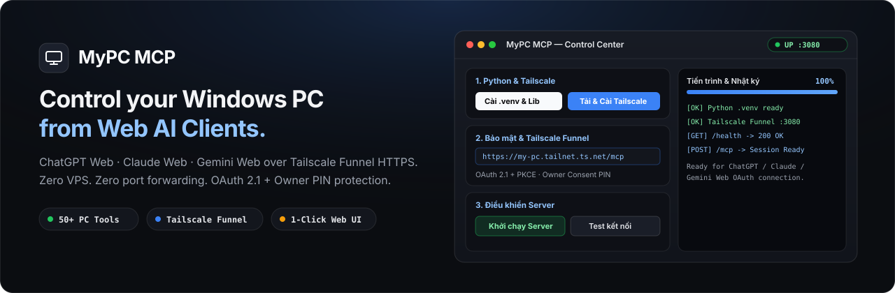

<div align="center">



<br />

# MyPC MCP (`mypc`)

**Kết nối trực tiếp ChatGPT Web, Claude Web và Gemini Web vào máy tính Windows của bạn qua Tailscale Funnel HTTPS — không cần VPS, không cần mở port router.**

[](https://www.python.org/downloads/)
[](https://modelcontextprotocol.io/)
[](https://tailscale.com/)
[](#bảo-mật)
[](#cài-đặt-nhanh)
[](LICENSE)

</div>

---

## Tại sao nên dùng MyPC MCP?

Các AI Agent chạy trên máy đã có thể thao tác trực tiếp, nhưng các phiên bản **AI Web** (**ChatGPT Web, Claude Web, Gemini Web**) lại không thể chạm vào ổ đĩa, terminal hay mã nguồn trên máy Windows của bạn. **MyPC MCP** giải quyết việc này chỉ trong vài phút:

- **Giao diện cài đặt cục bộ 1-Click (`setup_ui.bat`):** Mở bảng điều khiển trực quan tại `http://127.0.0.1:3099` (chạy bằng thư viện chuẩn Python, không cần cài gói trước) để tải Tailscale trực tiếp không cần `winget`, theo dõi thanh tiến trình realtime, cấu hình PIN, bật/tắt server và copy URL kết nối.
- **Không cần thuê VPS hay mở port router:** Sử dụng **Tailscale Funnel** để cấp sẵn URL HTTPS chính chủ `https://<tên-máy>.<tailnet>.ts.net/mcp` kèm chứng chỉ TLS tự động.
- **50+ công cụ toàn máy (Full-Machine):** Duyệt ổ đĩa/thư mục, đọc file lớn theo dòng, sửa file bằng `patch_file` có kiểm tra hash, `grep`, nén/giải nén chống zip-slip, chạy CLI (`exec_command`), quản lý tiến trình nền, `pytest`, Git cục bộ và Chrome CDP (`localhost:9222`).
- **Tự động cài bằng AI Agent (`AI_SETUP.md`):** Hỗ trợ giao hẳn cho Claude Code / Cursor / Windsurf / Antigravity tự động setup và kiểm thử từ A–Z.

---

## Cài đặt nhanh

### Cách 1 — Giao diện trực quan (Khuyên dùng)

1. Tải mã nguồn về máy:
   ```bash
   git clone https://github.com/Thangterter-Pipo/mypc-mcp.git
   cd mypc-mcp
   ```
2. Nhấp đúp **`setup_ui.bat`** (hoặc chạy `python setup_ui.py`).
3. Trên giao diện **`http://127.0.0.1:3099`**, bấm lần lượt từ **Bước 1 → Bước 4**:
   - **Bước 1:** Bấm **Cài `.venv` & Thư viện** → bấm **Tải & Cài Tailscale** → **Đăng nhập** & bật **MagicDNS**.
   - **Bước 2:** Kiểm tra/sinh **Consent PIN**, bấm **Lưu `.env`** → **Bật Tailscale Funnel (HTTPS)**.
   - **Bước 3:** Bấm **Khởi chạy Server** và **Test kết nối** (có thể bấm thêm **Khởi động MCP cùng Windows**).
   - **Bước 4:** Bấm **Copy URL** và dán vào mục thêm **Custom MCP Connector** (chọn **OAuth**) trên ChatGPT / Claude / Gemini Web.

### Cách 2 — Giao cho AI Agent tự cài đặt

Mở thư mục dự án bằng AI Agent có quyền chạy lệnh (Claude Code, Cursor, Windsurf, Antigravity, Codex CLI, Gemini CLI...) và dán câu lệnh sau (xem chi tiết tại [AI_SETUP.md](AI_SETUP.md)):

```text
Hãy đọc file AI_SETUP.md và tự động cài đặt, cấu hình Tailscale, chạy kiểm thử và bàn giao cấu hình MyPC MCP trên máy tính này cho tôi.
```

### Cách 3 — Cài đặt bằng dòng lệnh (PowerShell)

```powershell
# 1. Tạo .venv, cài thư viện và tự sinh .env (API Key + Consent PIN)
.\scripts\install.ps1

# 2. Bật Tailscale Funnel (HTTPS công khai có xác thực OAuth + PIN)
.\scripts\tailscale_setup.ps1 -Mode funnel

# 3. Khởi chạy server chạy ngầm
.\start_mypc.bat start
.\start_mypc.bat status
```

---

## Kiến trúc hệ thống

```text
ChatGPT Web / Claude Web / Gemini Web
        │  HTTPS (Auto TLS) + OAuth 2.1 (PKCE + Owner Consent PIN)
        ▼
Tailscale Funnel (https://<machine>.<tailnet>.ts.net)
        │  Reverse proxy cục bộ (không cần VPS, không mở port router)
        ▼
127.0.0.1:3080/mcp  ← MyPC MCP Server (FastMCP 3.x on Windows)
```

---

## Bảo mật

- **Chạy đúng quyền user Windows:** Không leo thang đặc quyền, không bypass Windows ACL/UAC.
- **Xác thực OAuth 2.1 + PKCE + Owner PIN:** Trang `/consent` yêu cầu nhập `MYPC_MCP_CONSENT_PIN` (tự hủy ticket sau 5 lần sai) kết hợp allowlist `redirect_uri` (ChatGPT, Claude, Google/Gemini, Meta AI).
- **Giới hạn ổ đĩa & Audit Log:** Hỗ trợ khóa phạm vi ổ đĩa qua `MYPC_MCP_ALLOWED_DRIVES` và ghi nhật ký gọi tool (tự động che toàn bộ token/mật khẩu) tại `%LOCALAPPDATA%\MyPCMcp\audit.jsonl`.
- **Setup UI cô lập cục bộ:** Giao diện cài đặt chỉ lắng nghe trên `127.0.0.1:3099` và kiểm tra `Host` header, không bao giờ mở ra ngoài mạng.

> Xem thêm lưu ý bảo mật chi tiết tại [docs/SECURITY.md](docs/SECURITY.md).

---

## Tài liệu chi tiết

| Tài liệu | Nội dung |
| :--- | :--- |
| [AI_SETUP.md](AI_SETUP.md) | Quy trình chuẩn 6 bước để AI Agent tự động cài đặt & kiểm thử |
| [docs/ARCHITECTURE.md](docs/ARCHITECTURE.md) | Kiến trúc module, luồng kết nối và cơ chế supervisor |
| [docs/CLIENT_SETUP.md](docs/CLIENT_SETUP.md) | Hướng dẫn kết nối chi tiết cho ChatGPT Web, Claude Web, Gemini Web |
| [docs/TOOLS.md](docs/TOOLS.md) | Danh sách đầy đủ 50+ công cụ MCP |
| [docs/SECURITY.md](docs/SECURITY.md) | Mô hình bảo mật và các khuyến nghị vận hành an toàn |

---

## Kiểm thử

```powershell
.venv\Scripts\python.exe -m pytest tests/ -v
```

## Đóng góp & Giấy phép

Dự án phát hành theo giấy phép [MIT](LICENSE). Nếu thấy **MyPC MCP** hữu ích, hãy tặng repo một **Star** để ủng hộ nhé!
